

# مكتبة موشن ڤاليلا

**من فكرة… لموشن جاهز بهوية ڤاليلا.**

مكتبة على الماك بتعمل موشنز ڤاليلا من الأول للآخر:

1. تكتب طلبك في **مطبخ الموشن**.
2. كلود يبني الموشن بالألوان والخطوط والعطور الصح.
3. تعدّل أي حاجة فيه من **التايم لاين** زي برامج المونتاج، وتطلّع الفيديو النهائي.

📄 **الشرح كامل كملف PDF:** [مكتبة موشن ڤاليلا - الشرح.pdf](docs/مكتبة%20موشن%20ڤاليلا%20-%20الشرح.pdf)

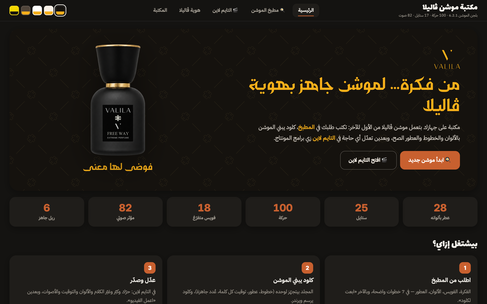

---

## المحتويات

- [الفكرة في سطرين](#الفكرة-في-سطرين)
- [إزاي تفتحها](#إزاي-تفتحها)
- [الأقسام](#الأقسام)
- [الصفحة الرئيسية](#الصفحة-الرئيسية)
- [مطبخ الموشن](#مطبخ-الموشن)
- [التايم لاين](#التايم-لاين)
- [هوية ڤاليلا](#هوية-ڤاليلا)
- [المكتبة](#المكتبة)
- [من الفكرة للفيديو](#من-الفكرة-للفيديو)

---

## الفكرة في سطرين
بدل ما كل موشن يتعمل من الصفر:

- **الهوية** محفوظة مرة وحدة.
- **الستايلات والحركات والأصوات والفويس** متجمّعة في مكان واحد.
- **الطلب** بيتكتب بخطوات واضحة.
- **أي تعديل** بعد كده بيحصل على الموشن نفسه، مش على فيديو مسطّح.

## إزاي تفتحها

- المكتبة **بتشتغل لوحدها** أول ما الماك يفتح.
- تفتحها من المتصفح في أي وقت، من الرابط المحفوظ عندك.
- لو وقفت لأي سبب، بترجع تشتغل لوحدها بعد ثواني.

## الأقسام

| القسم | بيعمل إيه |
|---|---|
| 🏠 **الرئيسية** | تعريف سريع بكل قسم، بعروض تفاعلية تجرّبها بإيدك |
| 🍳 **مطبخ الموشن** | طلب موشن جديد في 7 خطوات، وبالآخر يروح لكلود |
| 🎬 **التايم لاين** | مونتاج على الموشن الجاهز: تحريك، كلام، ألوان، توقيت، أصوات |
| 🎨 **هوية ڤاليلا** | الألوان والخطوط والشعار والعطور والقواعد |
| 📚 **المكتبة** | الستايلات، الحركات، حركة الكلام، الأصوات، الفويس |

الشريط اللي فوق (الاسم والأقسام والألوان) **ثابت** طول ما إنت بتنزل في أي صفحة، والصفحات مظبوطة على شاشات الماك كلها.

---

## الصفحة الرئيسية
بدل الصور، كل قسم ليه **عرض صغير تفاعلي** بيشتغل لوحده، وتقدر تلعب فيه:

<table>
<tr>
<td width="50%" align="center"> <b>أول الصفحة</b>: الفكرة، وزرارين للبداية، وأرقام المكتبة</td>
<td width="50%" align="center">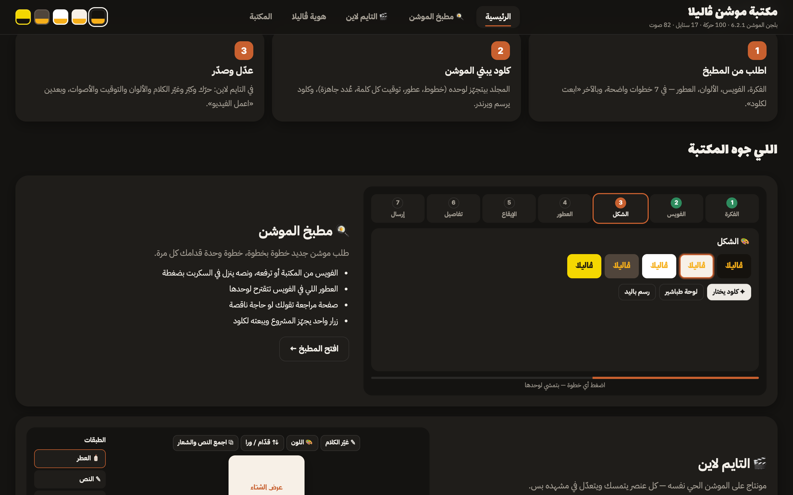 <b>العروض التفاعلية</b>: خطوات المطبخ بتمشي لوحدها، والتايم لاين المصغّر تسحب فيه</td>
</tr>
</table>

- **المطبخ:** الخطوات السبعة بتمشي قدامك، وتقدر تضغط على أي خطوة.
- **التايم لاين:** ريل صغير. تسحب العناصر، وتكبّر، وتغيّر الكلام واللون، وتسحب الوقت.
- **الهوية:** تضغط على طقم ألوان فالبوستر بيتلوّن، والعطور بتتقلّب.
- **المكتبة:** الستايلات بتشتغل لما توقف عليها، والأصوات بتتسمع، وحركات الكلام بتتعاد.
- **تحتها:** ريلاتك (ضغطة على أي ريل تفتحه في التايم لاين)، وآخر طلباتك.

---

## مطبخ الموشن
طلب موشن جديد في **7 خطوات**، وتظهر خطوة وحدة قدامك كل مرة:

| # | الخطوة | فيها |
|:-:|---|---|
| 1 | 💡 الفكرة | الاسم، والعرض، والنوع، والمدة، و**مقاس الشاشة**، و**الفريمات**، ووصف الفكرة |
| 2 | 🎙 الفويس والسكربت | الفويس الأول (من المكتبة، أو ترفعه، أو بعدين، أو بلا)، ونصّه ينزل في السكربت بضغطة |
| 3 | 🎨 الشكل | طقم الألوان والستايل، ومعاينته شغالة جنبك |
| 4 | 🧴 العطور | العطور اللي في الفويس بتتقترح لوحدها |
| 5 | ⏱ الإيقاع | سريع أو هادي، والموسيقى، والحركات والأصوات اللي اخترتها من المكتبة |
| 6 | 📝 تفاصيل | لازم يظهر، ممنوع، مراجع، ملاحظات (اختياري) |
| 7 | 🚀 مراجعة وإرسال | كل اختياراتك في جدول، واللي ناقص بيطلع بالأحمر |

<table>
<tr>
<td width="50%" align="center">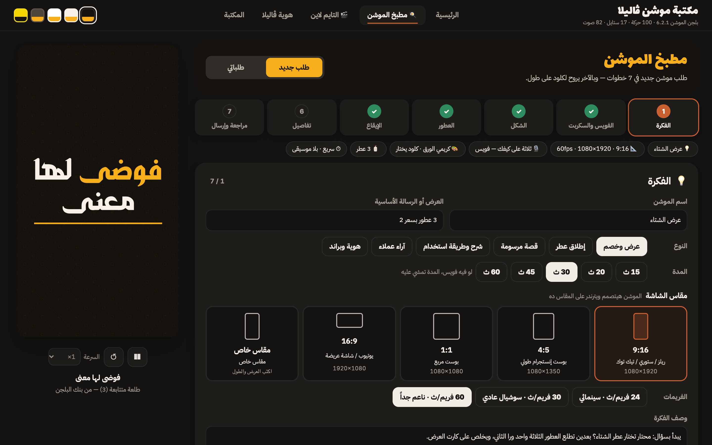 <b>الخطوات</b>: شريط الخطوات فوق، والملخص تحته، وزرار «التالي»</td>
<td width="50%" align="center">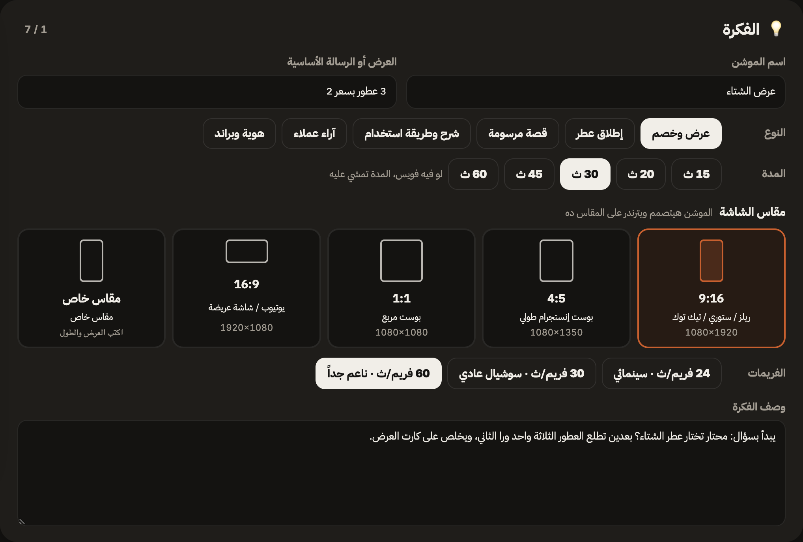 <b>المقاس والفريمات</b>: ريلز، أو بوست طولي، أو مربع، أو يوتيوب، أو مقاس خاص · 24 / 30 / 60 فريم</td>
</tr>
<tr>
<td width="50%" align="center">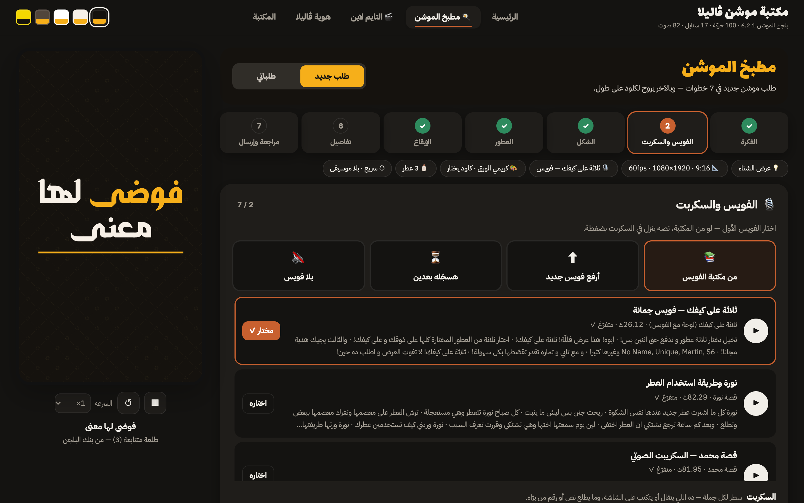 <b>الفويس والسكربت</b>: تختار الفويس، ونصّه ينزل في السكربت</td>
<td width="50%" align="center">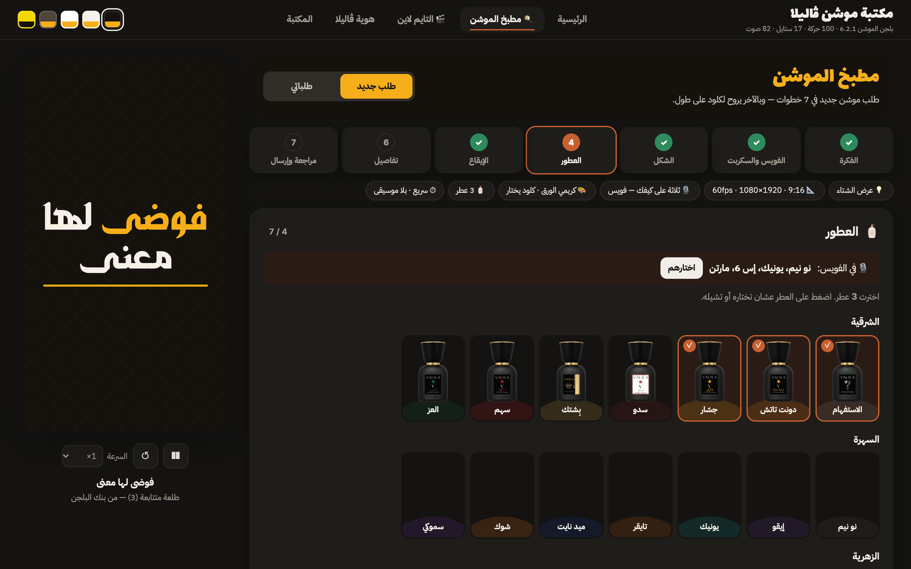 <b>العطور</b>: كل عطور ڤاليلا بصورها، والمقترح من الفويس فوق</td>
</tr>
<tr>
<td colspan="2" align="center">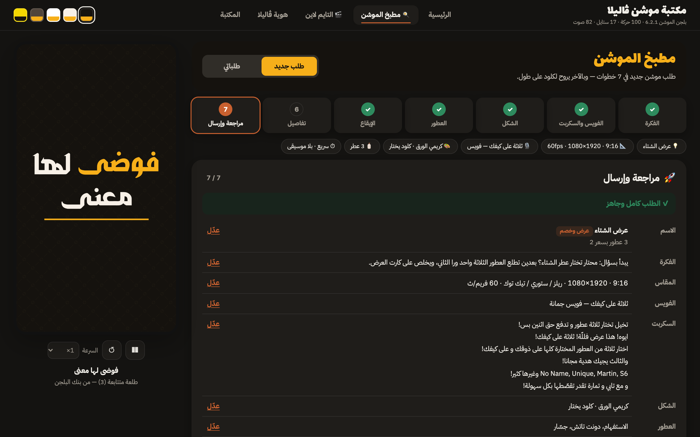 <b>المراجعة والإرسال</b>: جنب كل سطر «عدّل»، وزرار «ابعت لكلود»</td>
</tr>
</table>

**لما تدوس «ابعت لكلود»:**

1. الطلب بيتحفظ.
2. مجلد الموشن بيتجهّز لوحده، وفيه الخطوط والعطور والفويس وتوقيت كل كلمة.
3. تنسخ الأمر وتلصقه لكلود، أو تفتح كلود مباشرة بزرار، والموشن يبدأ.

---

## التايم لاين
مونتاج على **الموشن الحي نفسه**: كل عنصر في الفيديو يتمسك ويتعدّل **في مشهده بس**، وكل تعديل مسودة لحد ما تدوس **«💾 احفظ»**.

<table>
<tr>
<td colspan="2" align="center">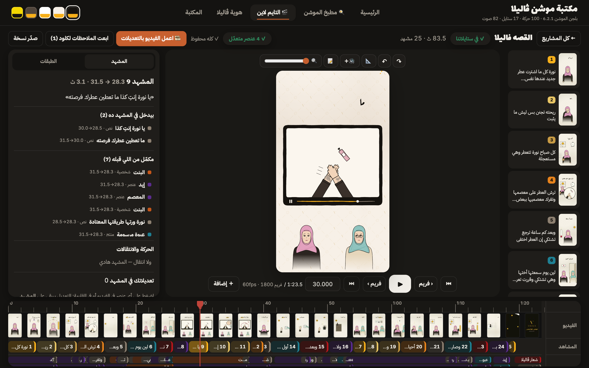 <b>شاشة المونتاج</b>: الفيديو كبير في النص، والمشاهد عمود على اليمين، ولوحة التعديل على الشمال، والمسارات تحت</td>
</tr>
</table>

### تحريك أي عنصر

- **اضغط على العنصر واسحبه** على طول، وهيمشي مع الماوس بسلاسة.
- **الأركان** للتكبير والتصغير.
- **المغناطيس** بيلزّق العنصر في نص الشاشة وحدود المنطقة الآمنة.
- **لوحة الخصائص** فيها: المكان، والحجم، والدوران، والشفافية، والإخفاء، والتوسيط، والرجوع للأصل.
- لما تحرّك عنصر زي **الشاشة**، كل اللي جوّاها بيتحرك معاها.

<table>
<tr>
<td width="50%" align="center">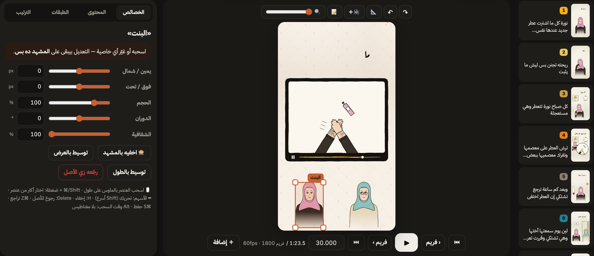 <b>الخصائص</b>: مكان، وحجم، ودوران، وشفافية، وإخفاء</td>
<td width="50%" align="center">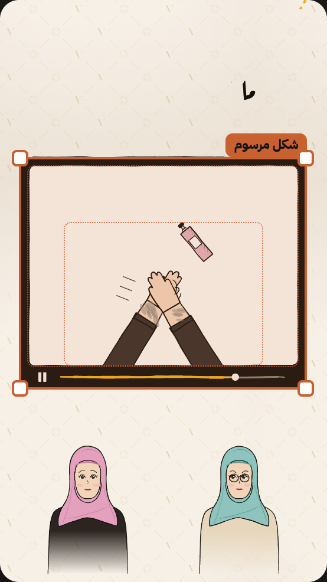 <b>اللي جوّه يمشي معاه</b>: الشاشة ومحتواها مع بعض</td>
</tr>
</table>

### اختيار أكتر من عنصر والمجموعات (زي Canva)

- **اضغط على أكتر من عنصر وإنت ماسك Shift** عشان تختارهم مع بعض.
- **اسحب على مكان فاضي** فيطلع مستطيل، وكل اللي جوّاه بيتحدد.
- **«اجمعهم مجموعة»:** أول ضغطة على أي عنصر منهم تختار المجموعة كلها، والضغطة التانية تختار العنصر ده لوحده.

<table>
<tr>
<td width="50%" align="center">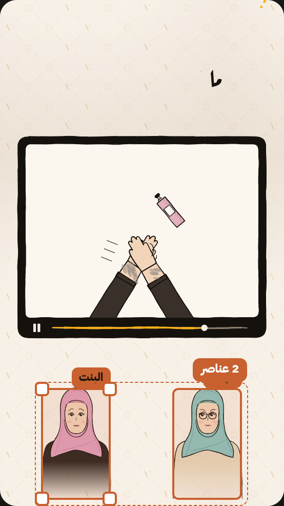 <b>الاختيار بمستطيل</b>: يتحركوا كلهم مع بعض</td>
<td width="50%" align="center">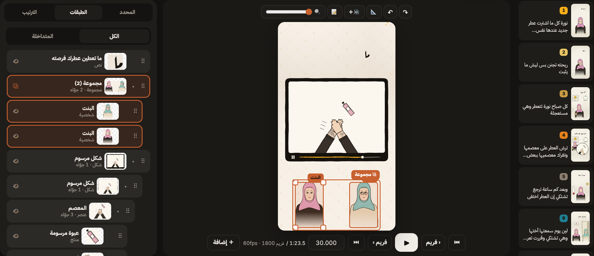 <b>الطبقات</b>: كل عنصر بصورته، والمجموعات، واللي جوه بعض</td>
</tr>
</table>

### الطبقات والترتيب والمحاذاة

- **الطبقات:**
    - اللي فوق في القايمة هو اللي قدّام في الفيديو.
    - اسحب الصف عشان تغيّر ترتيبه.
    - 👁 بتخفي العنصر في المشهد.
- **الترتيب:** لقدّام، لورا، قدّام الكل، ورا الكل.
- **المحاذاة:** للصفحة، جوه المنطقة الآمنة، أو العناصر لبعض.

<table>
<tr>
<td width="50%" align="center">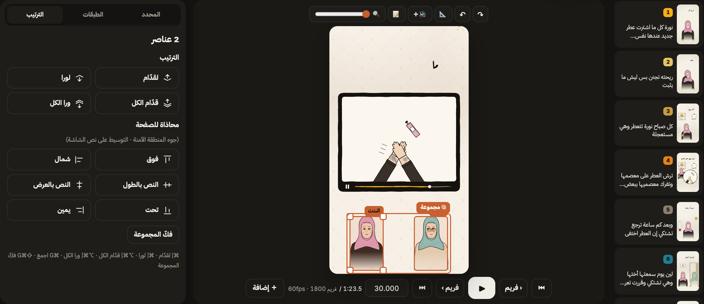 <b>الترتيب والمحاذاة</b></td>
<td width="50%" align="center">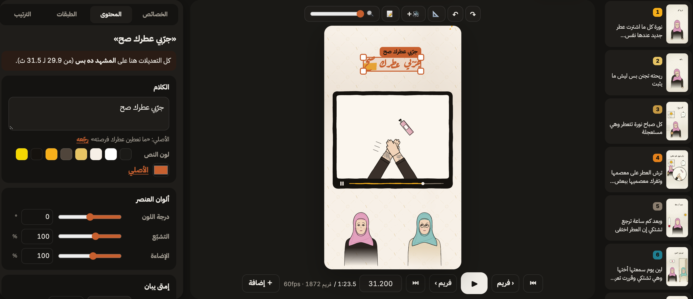 <b>المحتوى</b>: الكلام، ولون النص، وألوان العنصر، والتوقيت</td>
</tr>
</table>

### المحتوى والتوقيت

- **الكلام:** تكتب الكلام الجديد لأي نص أو كابشن، حتى لو بيطلع كلمة كلمة.
- **لون النص:** بألوان ڤاليلا أو أي لون.
- **ألوان أي عنصر:** درجة اللون، والتشبّع، والإضاءة.
- **إمتى يبان:** يبان من / يختفي عند، مع تلاشي ناعم.
- **حركته:** تأخّر دخول العنصر أو تقدّمه، أو تسرّع حركته أو تبطّأها.

### إضافة عناصر جديدة

- زرار **«＋ إضافة»** بيضيف **نص**، أو **شعار ڤاليلا**، أو **صورة أي عطر**.
- العنصر المضاف بيتسحب ويتعدّل زي أي عنصر.
- تختار هو يظهر من إمتى لإمتى، وطريقة دخوله: تلاشي، أو نطّة، أو طلوع.

<table>
<tr>
<td width="50%" align="center">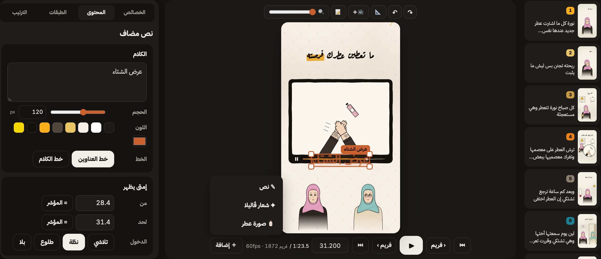 <b>إضافة</b>: نص، أو شعار، أو عطر</td>
<td width="50%" align="center">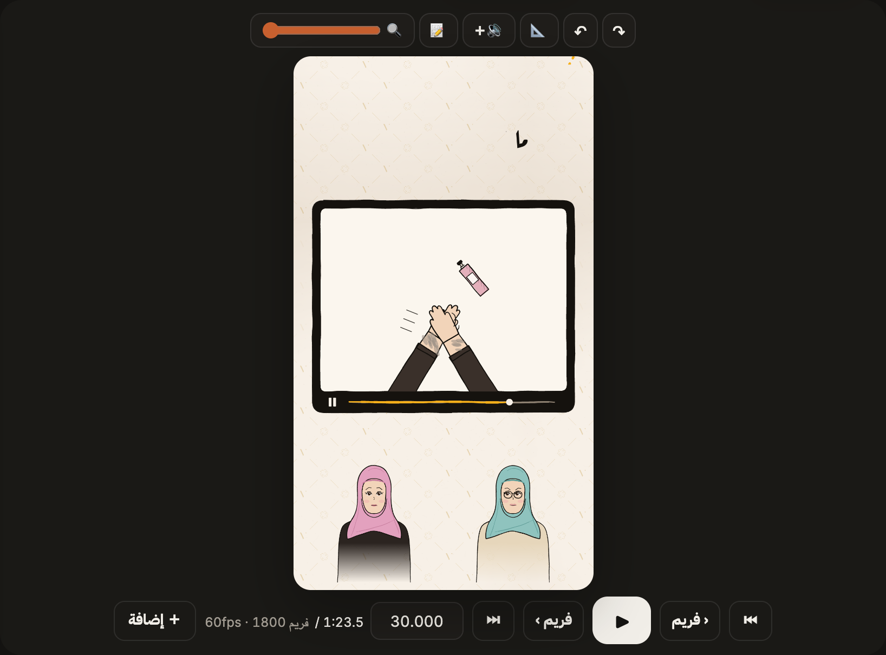 <b>الأدوات والوقت</b>: صف أدوات صغير فوق الفيديو، وتحته التشغيل وفريم بفريم ومربع الوقت</td>
</tr>
</table>

### الوقت والفريمات

- **الخط الأحمر:** ليه مقبض تسحبه، وتقدر تسحب كمان من المسطرة أو من شريط صور الفيديو.
- **«‹ فريم» و«فريم ›»:** فريم واحد في كل ضغطة، ولو ثبّت صباعك بيفضل يمشي.
- **مربع الوقت:** تكتب فيه وقت بالظبط، أو رقم فريم.
- **التكبير:** بيوصل لحد الفريم الواحد.

<table>
<tr>
<td align="center">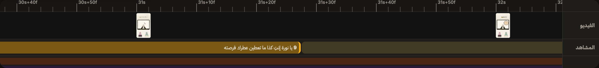 <b>تكبير لحد الفريم</b>: المسطرة بالثواني والفريمات</td>
</tr>
<tr>
<td align="center">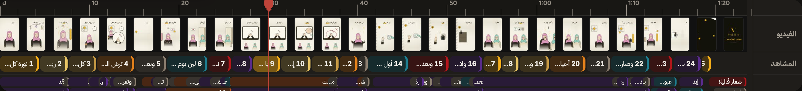 <b>المسارات</b>: الفيديو، والمشاهد، والعناصر، والحركة والانتقالات، والفويس، والأصوات، والملاحظات</td>
</tr>
</table>

### الأصوات

- **مؤثر صوتي جديد:** في أي لحظة، وتسحبه وتغيّره وتسمعه في ثواني.
- **الريلات القديمة:** المؤثرات الجديدة بتنزل فوق صوتها زي ما هو.
- **«🔇 اسكت هنا»:** بيوطّي المؤثرات القديمة بس في اللحظة دي، والفويس بيفضل زي ما هو.

### الحفظ وعمل الفيديو

- **«💾 احفظ»** بيحفظ كل اللي عملته، و**«إلغاء التعديلات»** بيرجّع آخر حفظ.
- **«🎞 اعمل الفيديو بالتعديلات»** بيطلّع الفيديو النهائي، وبيوريك النسبة وهو شغال.
- **«صدّر نسخة»** بيحط الفيديو جنب الريلات.
- **«ابعت الملاحظات لكلود»:** أي تعديل أكبر بتكتبه كملاحظة على اللحظة دي مع صورتها، وكلود بيطبّقه.
- **تعديلاتك محمية:** حتى لو الموشن نفسه اتعدّل بعد كده، كل تعديل بيلاقي عنصره لوحده.
- **«＋ ضيف ستايله للمكتبة»:** يحط الموشن ده في «ستايلاتنا» عشان تختاره في المطبخ بعد كده.

---

## هوية ڤاليلا

- كل الهوية في مكان واحد: **السلوغن**، و**أطقم الألوان**، و**الخطوط**، و**الشعار**، و**النقش**، و**كل العطور بصورها وألوانها**، و**قواعد الهوية**.
- كل موشن بيمشي عليها لوحده.

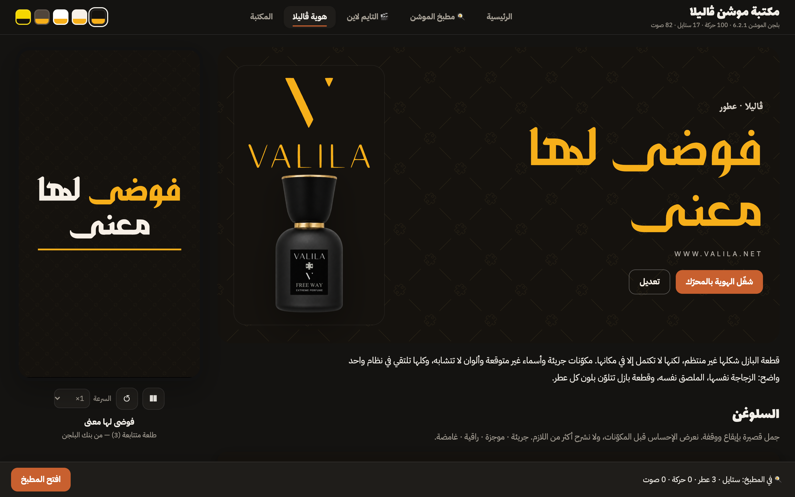

---

## المكتبة

| الجزء | فيه |
|---|---|
| **الستايلات والعُدد** | ستايلاتنا من الريلات اللي عملناها (مقطع حقيقي لكل واحد)، وستايلات البلجن |
| **الفويس أوفر** | كل فويسات ڤاليلا، كل واحد متفرّغ بتوقيت كل كلمة |
| **الحركات** | 100 حركة، تتشاف حيّة |
| **حركة الكلام** | طرق ظهور الكلام والكابشن |
| **الأصوات** | 82 مؤثر صوتي، تتسمع بضغطة |

- أي حاجة عجبتك ليها زرار **«+ للمطبخ»**، فتدخل في طلبك الجاي على طول.

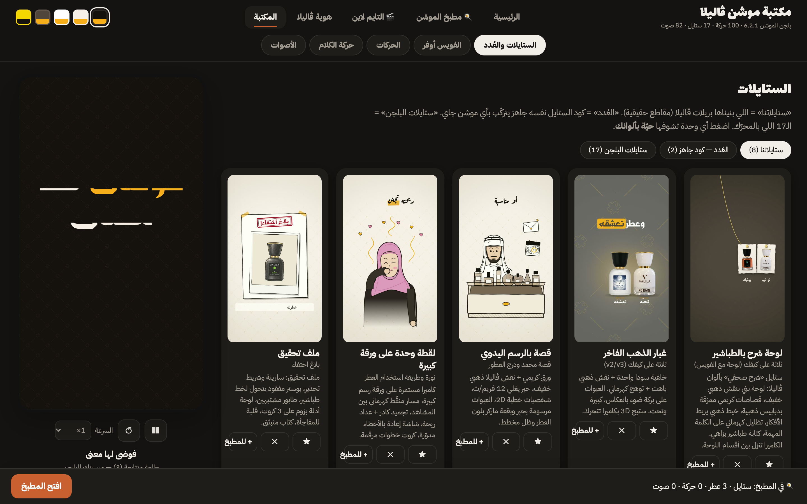

---

## من الفكرة للفيديو

| | الخطوة | فين |
|:-:|---|---|
| 1 | تكتب الفكرة وتختار الفويس والشكل والعطور والمقاس | 🍳 مطبخ الموشن |
| 2 | «ابعت لكلود»، والمجلد بيتجهّز لوحده | 🍳 مطبخ الموشن |
| 3 | كلود يبني الموشن ويطلّع أول نسخة | كلود |
| 4 | تفتحه في التايم لاين وتعدّل اللي عايزه | 🎬 التايم لاين |
| 5 | «💾 احفظ»، وبعدين «🎞 اعمل الفيديو» | 🎬 التايم لاين |
| 6 | «صدّر نسخة»، والفيديو يبقى جاهز للنشر | 🎬 التايم لاين |

